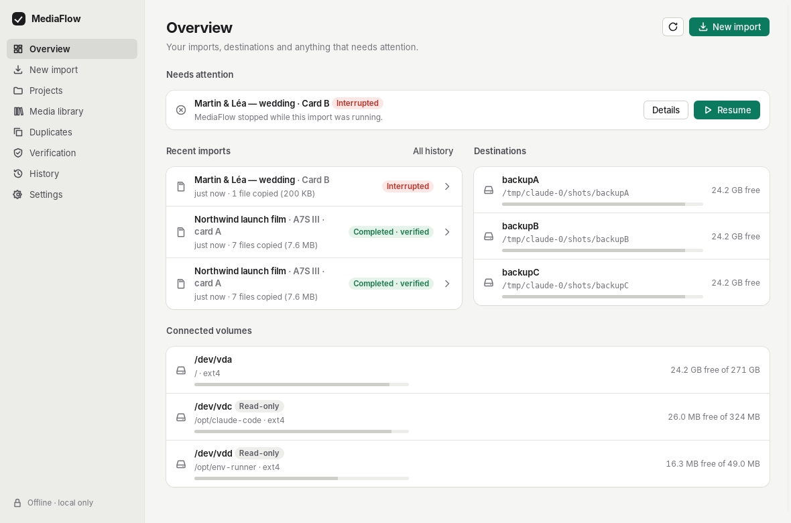
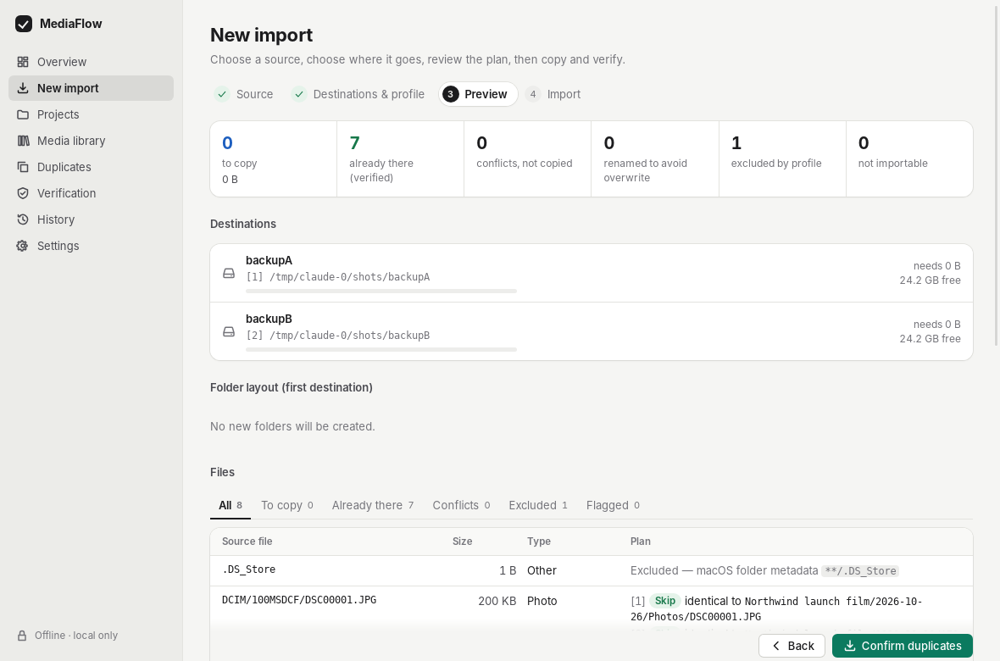
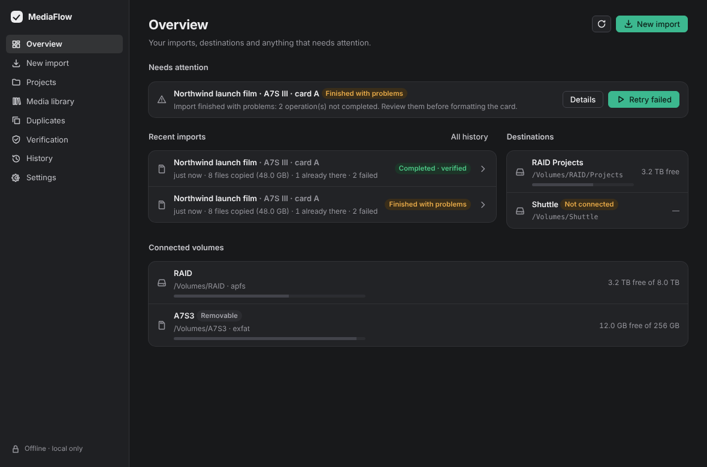

<div align="center">


# MediaFlow

**Import your media. Every file is verified. You stay in control.**

Verified, organized backups of your cards, cameras, phones and drives —
for macOS, Windows and Linux. Offline. No account. Never deletes your files.

[**Download**](#download) · [Features](#what-it-does) · [User guide](docs/USER_GUIDE.md) · [Build from source](#build-from-source)



</div>

> **Status: 0.1, pre-release.** The test suite passes on macOS, Windows and
> Linux in CI and the installers build on all three. The app has only been
> used by hand on Linux so far, and builds are not yet signed by Apple or
> Microsoft. Please report anything odd — see [docs/ROADMAP.md](docs/ROADMAP.md).

## What it does

|  |  |
|---|---|
| **See the plan first** | Before anything is written: what will be copied, what is already at the destination (content-verified), what conflicts, what is excluded and why, and how much space you need. |
| **Every copy is proven** | The card is read once and fingerprinted (SHA-256) while it is read. Each copy is written to a temporary file, flushed, re-read and compared. Only then does it get its final name — with an operation that can never replace an existing file. |
| **Several backups at once** | One read of the card, one verified copy per destination. A failure on one drive never affects the others. |
| **Duplicates without guesswork** | A same name or a same size is never treated as "the same file". Only identical fingerprints are. |
| **Interruptions are normal** | Pause, unplug a drive, quit, lose power: resume re-checks the disks and continues. Nothing incomplete is ever reported as done. |
| **Always in view** | Menu-bar / tray icon with live progress, progress under the Dock or taskbar icon, native notifications, a macOS widget, and a prompt when you plug in a card. Nothing ever starts on its own. |
| **Is my backup complete?** | Check that one or more drives hold every file of a card, wherever the files were filed. A disconnected drive is reported as such, never as "missing files". |
| **Reports** | JSON and CSV for every import, and a searchable library of every verified copy. |

<p align="center">
  
  
</p>

## Download

Get the latest version from **[Releases](https://github.com/estebanbaigts/Mediaflow-/releases/latest)**:

| System | File | |
|---|---|---|
| **macOS** 11 or later, Apple Silicon & Intel (widget: macOS 14+) | `MediaFlow-macOS-universal.dmg` | open, drag MediaFlow to Applications |
| **Windows** 10 / 11 (64-bit) | `MediaFlow-Windows-x64-setup.exe` | run the installer (or use the `.msi`) |
| **Linux** (x86-64) | `MediaFlow-Linux-x86_64.AppImage` | make it executable and run it — or install the `.deb` (Ubuntu, Debian) / `.rpm` (Fedora) |
| Command line, any OS | `mediaflow-cli-…` | a single executable, see [Command line](#command-line) |

`SHA256SUMS` lists the fingerprint of every file if you want to check your download.

> No release yet? Every pull request also builds the installers: open the
> latest run under **Actions → CI**, then download `MediaFlow-macos-unsigned`,
> `MediaFlow-Windows-unsigned` or `MediaFlow-Linux-unsigned` from *Artifacts*.

### First launch

The builds are not yet signed by Apple or Microsoft, so your system asks for
confirmation once:

- **macOS** — right-click MediaFlow in Applications → **Open** → **Open**.
  If macOS still refuses: System Settings → Privacy & Security → **Open Anyway**.
  Allow notifications when asked. To add the widget: right-click the desktop →
  **Edit Widgets** → MediaFlow. *(The widget may require a build signed with
  your own Apple ID — see [docs/WIDGET.md](docs/WIDGET.md).)*
- **Windows** — if SmartScreen says "Windows protected your PC": **More info** →
  **Run anyway**.
- **Linux** — AppImage: `chmod +x MediaFlow-Linux-x86_64.AppImage` then run it.
  `.deb`: `sudo apt install ./MediaFlow-Linux-amd64.deb`.
  `.rpm`: `sudo dnf install ./MediaFlow-Linux-x86_64.rpm`.
  On GNOME, the tray icon needs the *AppIndicator* extension.

Then: **New import** → choose your card → choose where it goes → check the
plan → **Copy and verify**. Wait for **"Import complete — every file is
verified"** before formatting the card.

## Command line

The same engine, for scripts and power users:

```sh
mediaflow plan   /Volumes/A7S3 --dest /Volumes/RAID/Projects --project "Client X"
mediaflow import /Volumes/A7S3 --dest /Volumes/RAID/Projects --dest /Volumes/Shuttle --profile pro_video
mediaflow resume <session-id>
mediaflow verify /Volumes/A7S3 --dest /Volumes/RAID/Projects --profile youtube
mediaflow report <session-id> --format csv --out report.csv
mediaflow sessions | profiles | volumes | library <query>
```

Exit codes: `0` completed and verified · `2` finished with problems / not
proven complete · `3` paused or interrupted · `4` cancelled · `1` error.
Ctrl-C pauses safely (press again to cancel).

## Privacy

- No network connections, no account, no telemetry, no cloud.
- History and fingerprints live in one local database (file names, sizes,
  dates, SHA-256) — never file contents. It is not encrypted.
- Sources are only ever read. MediaFlow never deletes or overwrites your
  files; the only files it removes are its own incomplete `.mfpart-…` temporaries.

## Build from source

You need [Rust](https://rustup.rs) 1.89+ and [Node.js](https://nodejs.org) 22.

```sh
git clone https://github.com/estebanbaigts/Mediaflow-.git && cd Mediaflow-
cd app && npm ci
npx tauri dev          # run the app in development
npx tauri build        # installers in target/release/bundle/
```

| System | Extra requirements |
|---|---|
| macOS | Xcode command-line tools. For the app **with the widget**: `brew install xcodegen`, then `scripts/build-macos.sh` (see [docs/WIDGET.md](docs/WIDGET.md)). |
| Windows | Microsoft C++ Build Tools and WebView2 (preinstalled on Windows 10/11). |
| Linux | `sudo apt install libwebkit2gtk-4.1-dev libgtk-3-dev librsvg2-dev libayatana-appindicator3-dev` |

Command line only: `cargo build --release -p mediaflow-cli` → `target/release/mediaflow`.

Tests: `cargo test --workspace --exclude mediaflow-app` and `cd app && npm test`.

## Documentation

- [User guide](docs/USER_GUIDE.md) · [Menu bar, notifications & widget](docs/WIDGET.md)
- [Architecture](docs/ARCHITECTURE.md) · [Threat model](docs/THREAT_MODEL.md) · [Data-loss risks](docs/DATA_SAFETY.md)
- [Test plan](docs/TEST_PLAN.md) · [Roadmap](docs/ROADMAP.md) · [Release checklist](docs/RELEASE_CHECKLIST.md)
- [Contributing](CONTRIBUTING.md) · [Security policy](SECURITY.md) · [Changelog](CHANGELOG.md)

## License

[Apache-2.0](LICENSE)
